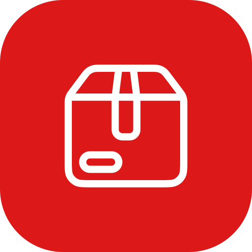
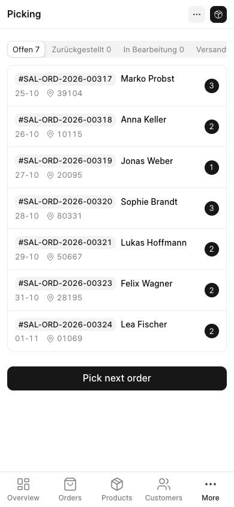
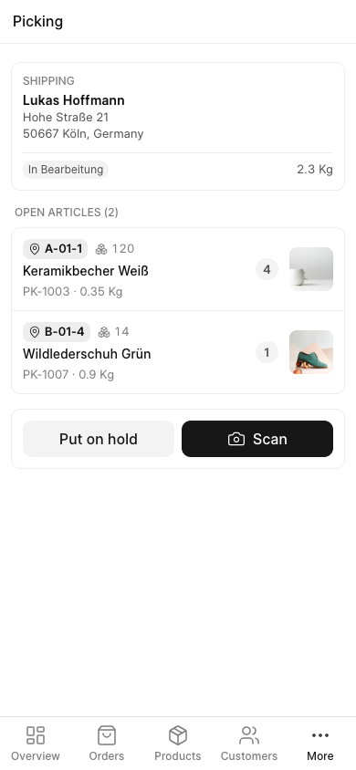
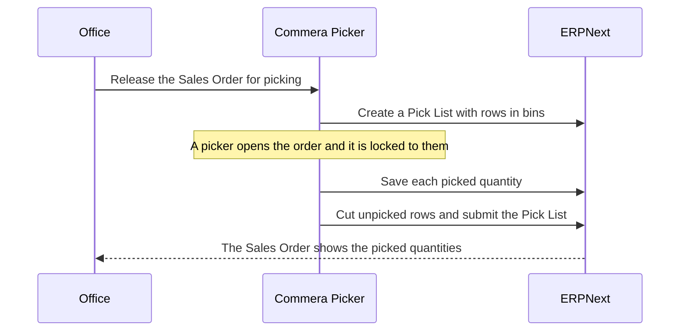

<div align="center" markdown="1">


<h1>Commera Picker</h1>

<a href="https://buildwithhussain.com"></a>

**Pick store orders from a phone with ERPNext Pick Lists**

<p>
	
	
</p>

</div>

Commera Picker lets warehouse staff pick store orders on a phone, inside the Commera dashboard. The office releases an order for picking, and a picker opens it, walks the bins, scans each article and marks the order ready to ship. It uses ERPNext Pick Lists, so stock, Sales Orders and Delivery Notes work as they always do.

### Order states

- **Offen**: released for picking, nobody has it yet
- **In Bearbeitung**: one picker has it open
- **Zurückgestellt**: put on hold after some articles were picked, so any picker can finish it
- **Versandfertig**: picked and submitted

### Features

- Release a submitted Sales Order for picking, which creates its Pick List
- Pickers choose their own orders, or take the oldest with "Pick next order"
- Opening an order locks it to that picker, and a second picker is told who has it
- Articles are sorted by bin, with the stock in that bin, the weight and a photo
- Scan with a hardware scanner or the phone camera, and a wrong article shows an alert
- Pick in full, pick part of a row, or mark an article not available
- Only what was picked is submitted, and the rest stays open on the Sales Order
- German translations included

### How it works



### Installation

You need Commera and ERPNext, on Frappe 16 or later.

```bash
bench get-app https://github.com/Rl0007/commera_picker
bench --site your.site install-app commera_picker
```

Installing adds the Picker role, a Picker role profile and the picking workflow on Pick List. Then give each picker a user with the Picker role profile, and put your bins as warehouses in one group with the store's warehouse beside them.

### Bins

Each bin is a warehouse. Put all bins in one group warehouse, for example "Hauptlager", next to the warehouse your store sells from. Commera Picker looks for stock in every warehouse of that group.

### Development

```bash
bench --site test_site set-config allow_tests true
bench --site test_site run-tests --app commera_picker
```

### Support

Found a bug or have a question? [Open an issue](https://github.com/Rl0007/commera_picker/issues).

## About BWH Studios

Commera Picker is developed and maintained by BWH Studios, a tech company based in Jagdalpur, Chhattisgarh,
specializing in Frappe customizations and consulting.

#### License

MIT
